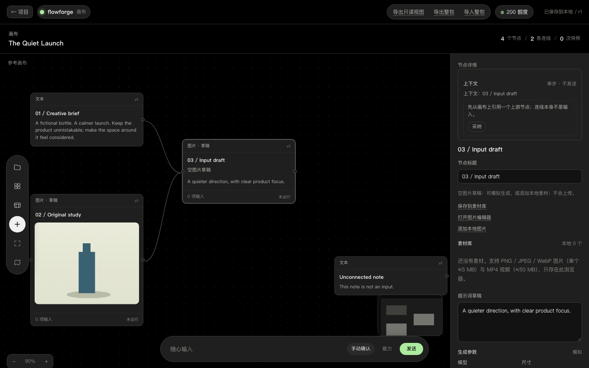
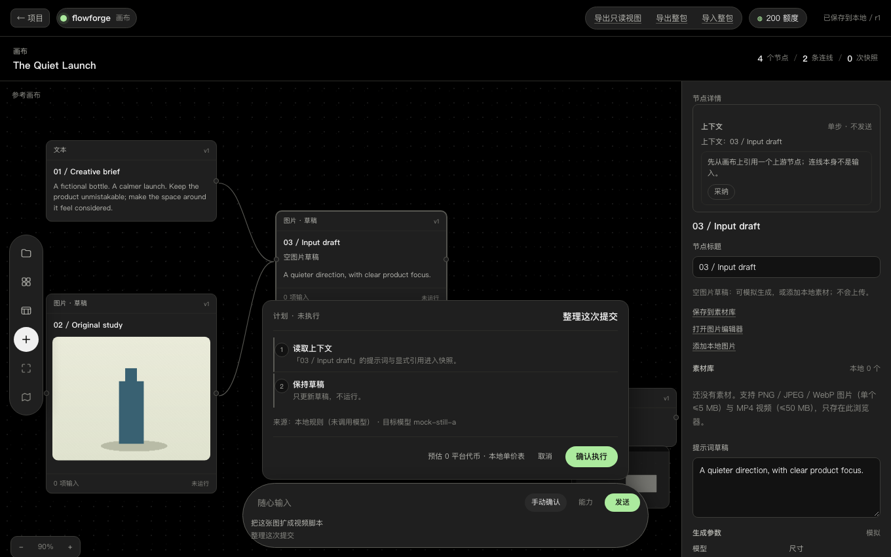
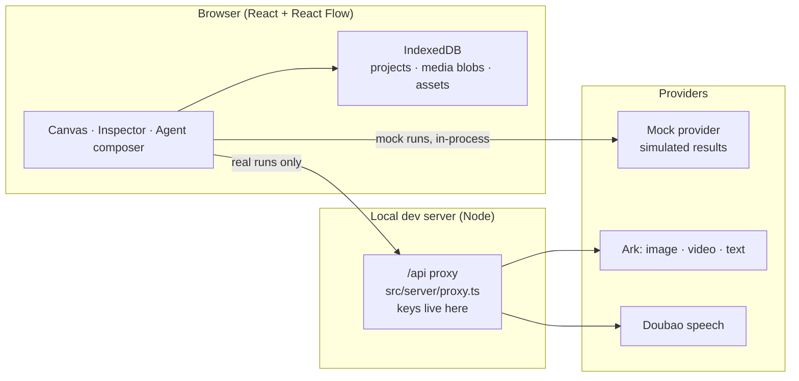

# FlowForge

An infinite-canvas AI creation workbench that is local-first and mock-first: nodes for text, image, video, audio and 3D sit on a canvas, edges express *candidate references*, and only the inputs you explicitly reference in a prompt ever enter a generation.

[](https://github.com/your-org/flowforge/actions/workflows/ci.yml)
[](LICENSE)
[](.nvmrc)

<!-- TODO: replace with the deployed demo URL once hosting is set up. -->


<p>
  
  
</p>

## Features

- **Reference edges, not execution graphs.** Connecting two nodes only proposes a candidate; checkboxes in the inspector decide what actually enters the run. Building, changing or deleting edges never calls a provider.
- **Immutable run snapshots.** A submitted run freezes its inputs as `(nodeId, revision)` pairs. Later edits to a source node never leak into an existing snapshot.
- **Mock-first generation.** Every media type has a mock path, clearly labelled `simulated`, so the full loop works with zero keys. A visible counter tracks provider calls.
- **Optional real providers.** Ark image (Seedream), Ark video (task submit → poll → download), Ark text (single chat completion) and Doubao speech (per-minute billing) are gated behind explicit switches and proxied through a local dev server — API keys never reach the browser.
- **Local-first persistence.** Projects, media blobs (checksum-validated) and the asset library live in IndexedDB. Full-bundle import/export and a static readonly HTML export are built in.
- **Creation tooling.** Image editor with simulated variants, timeline-based simulated cutting, templates that instantiate empty drafts, an asset library with categories, favourites and search.
- **Agent composer.** Plans come from local rules or an optional LLM planner and render as a plan card that never executes without explicit confirmation.
- **Undo everything.** Every project mutation records an undo command; autosave is debounced with revision conflict detection across tabs.

## Quick start

Requires Node 24 (see `.nvmrc`) and pnpm 12.

```bash
pnpm install
pnpm dev
```

Open `http://127.0.0.1:5173`. That's it — **mock mode needs no API key**, no account and no network. Every result is labelled `simulated`, and nothing leaves your machine.

## Real generation (optional)

Real providers are off by default. To enable them:

1. Copy the example config and fill in your keys:

   ```bash
   cp .env.example .env.local
   # edit .env.local: ARK_API_KEY, endpoint IDs, SPEECH_API_KEY, SPEECH_APP_ID ...
   ```

2. Restart `pnpm dev`. Enabled real models appear in the model dropdowns; runs route through the local `/api` proxy.

3. Check the switches before spending money: image/video/text follow the Volcano Ark console pricing, speech bills per minute. The invoice from your provider is always authoritative.

**Where do keys live?** Only in the Node process (`src/server/proxy.ts`). The browser receives inlined booleans (`ARK_ENABLED`, `SPEECH_ENABLED`, …) and never sees key material. `.env.local` is git-ignored.

## Architecture



- The browser never talks to a provider directly; real requests are forwarded by the dev-server proxy so keys stay in Node.
- The proxy keeps a loopback allowlist, single concurrency and a task table.
- Domain rules (nodes, references, snapshots, pricing, timeline, editor) are pure TypeScript under `src/domain/`, unit-tested without a DOM.

## Tests

```bash
pnpm typecheck    # tsc --noEmit
pnpm test         # unit tests (node --test, ~1 s)
pnpm test:e2e     # Playwright end-to-end suite (~2.5 min)
pnpm build        # typecheck + production build
```

CI (GitHub Actions) runs typecheck, unit, e2e (with Chromium) and build as parallel jobs; e2e failures upload their traces. New features are expected to come with tests — see [CONTRIBUTING.md](CONTRIBUTING.md) for the project invariants and PR checklist.

## Why it is built this way

Edges are references rather than a pipeline; runs pin immutable input revisions; simulated and real results never blur together; provider keys stay in the Node process. The reasoning, and the cost of each choice, is written down in [docs/design-notes.md](docs/design-notes.md).

## Roadmap

- [ ] Standalone server gateway + Docker deployment (move the proxy out of the dev server)
- [ ] Real-time collaboration on the canvas
- [ ] Mobile editing experience (today mobile gets a read-only summary)

## Disclaimer

FlowForge is an independently designed and implemented open-source project. It is not affiliated with, endorsed by, or connected to any third-party product or service, and it contains no third-party code, branding or assets. Provider names (Volcano Ark, Doubao) refer only to the APIs this project can optionally call; all trademarks belong to their respective owners. Simulated results are placeholders and are always labelled as such.

## License

[MIT](LICENSE) © 2026 FlowForge contributors

A Chinese version of this README is available at [README.zh-CN.md](README.zh-CN.md).
