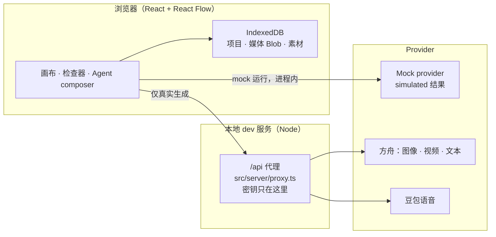

# FlowForge

一个本地优先、mock 优先的无限画布式 AI 创作工作台：文本、图片、视频、音频、3D 节点摆在画布上，连线只表达「候选参考」，真正进入生成的只有你在 Prompt 里显式引用的内容。

[](https://github.com/archibald-nice/flowforge/actions/workflows/ci.yml)
[](https://flowforge-beige-chi.vercel.app/)
[](LICENSE)
[](.nvmrc)

**[在线 demo →](https://flowforge-beige-chi.vercel.app/)** — 线上版本跑模拟模式：不要密钥、不调用任何 provider、结果标注 `simulated`。画布、引用、快照、持久化、撤销、编辑器等其余部分与本地完全同一套代码。


<p>
  
  
</p>

## 特性

- **连线是参考，不是执行图。** 连线只产生候选；真正进输入的是检查器里勾选的引用。建边、改边、删边都不会调用 provider。
- **不可变运行快照。** 提交时把输入冻结为 `(nodeId, revision)` 对；之后源节点再怎么改，都不会影响已有快照。
- **Mock 优先。** 每种媒体类型都有 mock 路径，结果一律标注 `simulated`，零密钥即可跑通完整闭环；界面上有 provider 调用计数。
- **可选真实 provider。** 方舟图像（Seedream）、方舟视频（任务提交 → 轮询 → 下载）、方舟文本（单次对话补全）、豆包语音（按分钟计费）都由显式开关控制，并经本地 dev 代理转发——API 密钥永远不进浏览器。
- **本地优先持久化。** 项目、媒体 Blob（带校验和）与素材库都存 IndexedDB；内置整包导入导出与静态只读 HTML 导出。
- **创作工具链。** 模拟变体图片编辑器、时间线模拟剪辑、只生成空草稿的模板库、带分类/收藏/搜索的素材库。
- **Agent composer。** 计划来自本地规则或可选 LLM 规划器，以计划卡呈现，未经明确确认绝不执行。
- **一切可撤销。** 每次数据变更都记录撤销命令；自动保存带防抖与跨标签页版本冲突检测。

## 快速开始

需要 Node 24（见 `.nvmrc`）与 pnpm 12。

```bash
pnpm install
pnpm dev
```

打开 `http://127.0.0.1:5173`。就这么简单——**mock 模式不需要任何 API key**、无需账号、不联网。所有结果都标注 `simulated`，没有任何数据离开你的电脑。

## 真实生成（可选）

真实 provider 默认关闭。启用方式：

1. 复制示例配置并填入密钥：

   ```bash
   cp .env.example .env.local
   # 编辑 .env.local：ARK_API_KEY、接入点 ID、SPEECH_API_KEY、SPEECH_APP_ID …
   ```

2. 重启 `pnpm dev`。启用的真实模型会出现在模型下拉框里；请求经本地 `/api` 代理转发。

3. 花钱前先确认开关：图像/视频/文本按火山方舟控制台计价，语音按分钟计费。provider 账单永远是最终依据。

**密钥在哪里？** 只存在于 Node 进程（`src/server/proxy.ts`）。浏览器只拿到内联的布尔开关（`ARK_ENABLED`、`SPEECH_ENABLED` 等），接触不到密钥本体。`.env.local` 已被 git 忽略。

## 架构



- 浏览器不直接访问 provider；真实请求由 dev 服务端代理转发，密钥留在 Node 侧。
- 代理带回环白名单、单并发与任务表。
- 领域规则（节点、引用、快照、计价、时间线、编辑器）是 `src/domain/` 下的纯 TypeScript，无 DOM 依赖，单测覆盖。

## 测试

```bash
pnpm typecheck    # tsc --noEmit
pnpm test         # 单测（node --test，约 1 秒）
pnpm test:e2e     # Playwright 端到端（约 2.5 分钟）
pnpm build        # 类型检查 + 生产构建
```

CI（GitHub Actions）以并行 job 跑 typecheck、单测、e2e（装 Chromium）与构建；e2e 失败会上传 trace。新功能应随附测试——项目不变量与 PR 清单见 [CONTRIBUTING.md](CONTRIBUTING.md)。

## 为什么这样设计

连线只表示参考而非执行管线；每次运行都会冻结不可变的输入版本；模拟结果与真实结果从不混淆；provider 密钥始终留在 Node 进程。每条决策的理由和代价写在 [docs/design-notes.md](docs/design-notes.md)。

## 路线图

- [ ] 独立服务端网关 + Docker 部署（把代理从 dev 服务里拆出来）
- [ ] 画布实时协作
- [ ] 移动端编辑体验（当前移动端只读摘要）

## 免责声明

FlowForge 是独立设计与实现的开源项目，与任何第三方产品或服务无关联、未获其认可，也不包含任何第三方的代码、品牌或资产。文中提到的 provider 名称（火山方舟、豆包）仅指本项目可选调用的 API；相关商标归各自权利人所有。模拟结果是占位内容，且始终带 `simulated` 标注。

## License

[MIT](LICENSE) © 2026 FlowForge contributors

English version of this README: [README.md](README.md).
